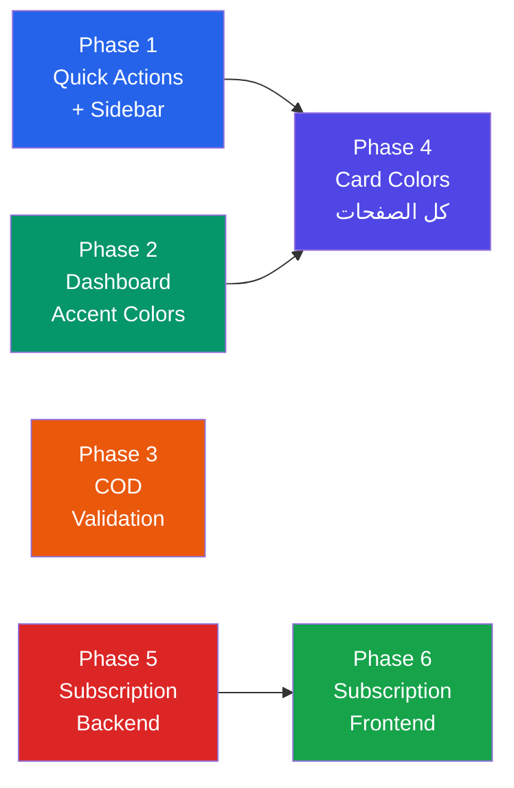

# 🛒 خطة تحسين Merchant Portal — الخطة الشاملة

---

## نظرة عامة على المراحل

| Phase | المحتوى | الوقت | الاعتمادية |
|-------|---------|-------|-----------|
| 1 | Quick Actions + Sidebar Grouping | 30 دقيقة | مستقل |
| 2 | Dashboard Accent Colors + تحسين | 1 ساعة | مستقل |
| 3 | COD Validation | 30 دقيقة | مستقل |
| 4 | Card Colors (data-accent) كل الصفحات | 1 ساعة | بعد Phase 2 |
| 5 | Subscription — Backend (Migration + API) | 2 ساعة | مستقل |
| 6 | Subscription — Frontend (صفحة الاشتراك) | 2 ساعة | بعد Phase 5 |

---

## Phase 1: Quick Actions Bar + Sidebar Grouping

```
You are working on a React 19 + Vite + TypeScript + Tailwind CSS logistics frontend at: e:\logistics\logistics-frontend

TASK: Add a Quick Actions bar to the Merchant Portal and group the standalone "Integrations" item into the Settings sidebar group.

## PART A: Add Quick Actions Bar to Merchant Portal

### Context:
The Admin dashboard has a QuickActionsBar component (src/shared/components/layout/QuickActionsBar.tsx). The Merchant Portal currently does NOT have one. The merchant layout is in src/layouts/MerchantLayout.tsx which uses AppShell with portalType="merchant".

### Steps:

1. Read src/layouts/MerchantLayout.tsx completely to understand its structure.

2. Read src/shared/components/layout/QuickActionsBar.tsx to understand how it works in admin.

3. Read src/shared/components/layout/AppShell.tsx to see how the QuickActionsBar is injected for admin.

4. Add a merchant-specific QuickActionsBar to the MerchantLayout. Either:
   - Option A: Pass merchant-specific quick actions to AppShell as a prop
   - Option B: Render a QuickActionsBar directly in MerchantLayout before the <Outlet />
   
   Choose whichever approach matches the existing admin implementation.

5. The merchant quick actions should be:

```tsx
const merchantQuickActions = [
  { 
    label: t('New Order', { defaultValue: 'New Order' }), 
    icon: <Plus size={15} />, 
    path: merchantPath('/orders/create'),
    capability: 'orders.create',
  },
  { 
    label: t('Track Shipment', { defaultValue: 'Track Shipment' }), 
    icon: <Search size={15} />, 
    path: merchantPath('/shipments'),
    capability: 'shipments.view',
  },
  { 
    label: t('Request Inbound', { defaultValue: 'Request Inbound' }), 
    icon: <PackageCheck size={15} />, 
    path: merchantPath('/warehouse/inbound-requests/create'),
    capability: 'warehouse.inbound_requests.create',
  },
  { 
    label: t('View Wallet', { defaultValue: 'View Wallet' }), 
    icon: <Wallet size={15} />, 
    path: merchantPath('/finance/wallet'),
    capability: 'wallet.view',
  },
  { 
    label: t('My Invoices', { defaultValue: 'My Invoices' }), 
    icon: <FileSpreadsheet size={15} />, 
    path: merchantPath('/finance/invoices'),
    capability: 'invoices.view',
  },
];
```

6. Each action should be wrapped in a capability/permission check. Look at how the admin QuickActionsBar handles permissions and follow the same pattern. If the merchant portal uses a different permission system (capabilities vs permissions), adapt accordingly.

## PART B: Group Integrations into Settings

### Context:
In MerchantLayout.tsx, "Integrations" is a standalone sidebar item between Finance and Settings groups.

### Steps:

1. In MerchantLayout.tsx, find the sidebar items array.

2. Find the standalone "Integrations" item:
```tsx
{
  type: 'link',
  path: merchantPath('/integrations'),
  label: 'Integrations',
  icon: <Plug size={18} />,
  capability: 'integrations.view',
}
```

3. REMOVE it from its current position.

4. ADD it inside the "Settings" group's children array, after "Portal Users":
```tsx
{
  type: 'group',
  label: 'Settings',
  icon: <Settings size={18} />,
  children: [
    { path: merchantPath('/profile'), label: 'Profile', icon: <UserRoundCheck size={18} />, role: 'owner' },
    { path: merchantPath('/users'), label: 'Portal Users', icon: <Users size={18} />, capability: 'users.view' },
    { path: merchantPath('/integrations'), label: 'Integrations', icon: <Plug size={18} />, capability: 'integrations.view' },  // ← MOVED HERE
    { path: merchantPath('/notifications'), label: 'Notifications', icon: <Bell size={18} />, capability: 'notifications.view' },
    { path: merchantPath('/attachments'), label: 'Attachments', icon: <Archive size={18} />, capability: 'attachments.view' },
  ],
}
```

5. Make sure the existing routes still work — we're only changing the sidebar placement, NOT the route paths.

## ⛔ STRICT SAFETY RULES — READ BEFORE WRITING ANY CODE

### DO NOT TOUCH these files/areas (unless explicitly listed in this task):
- DO NOT modify any file that is NOT mentioned in this prompt
- DO NOT modify src/index.css UNLESS adding quick-actions CSS that doesn't already exist
- DO NOT modify src/app/router.tsx
- DO NOT modify any shared component EXCEPT as needed to support merchant quick actions
- DO NOT modify any API service files, hooks, or query functions

### DO NOT change these things EVER:
- DO NOT change any API endpoint URLs, request payloads, or response handling
- DO NOT change any TypeScript interfaces or types
- DO NOT rename any existing CSS classes that are used elsewhere
- DO NOT remove any existing CSS rules — only ADD new ones or modify the specific ones mentioned
- DO NOT change any import paths of existing modules
- DO NOT delete any files
- DO NOT change any permission/capability checks logic
- DO NOT change any i18n/translation keys

### BEFORE modifying any file:
1. Read the ENTIRE file first
2. Change ONLY the lines specified — leave everything else untouched
3. Preserve all existing comments and formatting

### AFTER making changes:
1. Run: npm run build
2. If build fails, UNDO your last change and try a different approach
3. Do NOT "fix" build errors by modifying files outside this prompt's scope
```

---

## Phase 2: Dashboard Accent Colors + تحسين

```
You are working on a React 19 + Vite + TypeScript + Tailwind CSS logistics frontend at: e:\logistics\logistics-frontend

TASK: Apply semantic accent colors to the Merchant Dashboard stat cards and improve the dashboard layout.

File: src/features/merchant-portal/pages/MerchantDashboardPage.tsx

## CONTEXT:

The merchant dashboard has 8 stat cards with a custom "neon" styling. We need to replace that with the standard data-accent color system that's already defined in src/index.css (CSS variables like --accent-orders, --accent-shipments, --accent-success, etc. and the corresponding [data-accent="..."] CSS rules).

## STEPS:

1. Read MerchantDashboardPage.tsx completely.

2. Find EVERY stat card component rendered on this page. They likely use a custom HubStatCard, StatCard, or similar component with neon-style CSS.

3. Add the `data-accent` attribute to each stat card's wrapper element:

| Stat Card | data-accent value | Color meaning |
|-----------|------------------|---------------|
| Total Orders | "orders" | Blue — order metrics |
| Today's Orders | "orders" | Blue — order metrics |
| In Transit | "shipments" | Teal — shipment metrics |
| Delivered Today | "success" | Green — positive outcomes |
| Returned Shipments | "danger" | Red — returns/problems |
| Warehouse Stock | "inventory" | Emerald — inventory |
| Available Wallet | "finance" | Indigo — financial |
| Success Rate | "success" | Green — positive |

4. Check if the [data-accent="..."] CSS rules exist in src/index.css. They should already be defined with backgrounds like:
```css
[data-accent="orders"] { border-left: 3px solid rgb(var(--accent-orders)); ... }
```

If they DON'T exist yet, add them at the END of src/index.css. Use this pattern for EACH accent type:
```css
.ui-card--stat[data-accent="orders"],
.stat-card[data-accent="orders"] {
  border-left: 3px solid rgb(var(--accent-orders));
  background:
    radial-gradient(circle at 92% 110%, rgb(var(--accent-orders) / 0.06) 0 4.5rem, transparent 4.55rem),
    linear-gradient(145deg, var(--surface) 60%, rgb(var(--accent-orders) / 0.08));
}
```

Also check if the CSS variables (--accent-orders, --accent-shipments, etc.) exist in :root. If not, add them:
```css
:root {
  --accent-orders: 37 99 235;
  --accent-shipments: 13 148 136;
  --accent-success: 22 163 74;
  --accent-warning: 234 88 12;
  --accent-danger: 220 38 38;
  --accent-inventory: 5 150 105;
  --accent-finance: 79 70 229;
  --accent-drivers: 99 102 241;
}
```

5. If the cards use a custom "neon" class or inline styles for coloring, REMOVE only the neon-specific styles and replace with the data-accent approach. Keep everything else (card structure, content, icons).

6. Organize the stat cards in a clean 2-row grid:
   - Row 1: Total Orders, Today's Orders, In Transit, Delivered Today
   - Row 2: Returned, Warehouse Stock, Available Wallet, Success Rate

   Use the existing `stats-grid` class for layout.

7. KEEP the chart (Shipment Trends), Live Activity section, and all filters as-is. Only change the stat cards.

## ⛔ STRICT SAFETY RULES — READ BEFORE WRITING ANY CODE

### DO NOT TOUCH these files/areas (unless explicitly listed in this task):
- DO NOT modify any file that is NOT mentioned in this prompt
- DO NOT modify src/app/router.tsx
- DO NOT modify any Layout files
- DO NOT modify any shared components
- DO NOT modify any API service files, hooks, or query functions

### DO NOT change these things EVER:
- DO NOT change any API endpoint URLs, request payloads, or response handling
- DO NOT change any TypeScript interfaces or types
- DO NOT rename any existing CSS classes that are used elsewhere
- DO NOT remove any existing CSS rules — only ADD new ones or modify the specific ones mentioned
- DO NOT change any import paths of existing modules
- DO NOT delete any files
- DO NOT change any permission/capability checks
- DO NOT change any charts or data fetching logic
- DO NOT remove the Live Activity section or any filters

### BEFORE modifying any file:
1. Read the ENTIRE file first
2. Change ONLY stat card elements — leave everything else untouched

### AFTER making changes:
1. Run: npm run build
2. If build fails, UNDO your last change and try a different approach
3. Do NOT "fix" build errors by modifying files outside this prompt's scope
```

---

## Phase 3: COD Validation

```
You are working on a React 19 + Vite + TypeScript + Tailwind CSS logistics frontend at: e:\logistics\logistics-frontend

TASK: Add validation to the Merchant Order form so that when payment_type is "cod", the cod_amount MUST equal the total of all items (unit_price × quantity for each item).

File: src/features/merchant-portal/orders/components/MerchantOrderForm.tsx

## CONTEXT:

The merchant order form uses a StepWizard with 4 steps. Step 3 is "Items & Payment" which includes: Payment Type, COD Amount, and a dynamic list of Items (Product Name, SKU, Qty, Price, Weight, Notes). The form uses Zod for validation.

## STEPS:

1. Read MerchantOrderForm.tsx COMPLETELY. Understand:
   - The Zod schema name and structure
   - The exact field names for: payment_type, cod_amount, items array
   - Inside each item: the exact field names for unit_price and quantity
   - How superRefine is used (if at all)

2. Find the existing COD validation. It likely checks:
```typescript
if (payment_type === 'cod' && order_type !== 'return' && cod_amount <= 0) { ... }
```

3. ADD a NEW validation rule (do NOT remove the existing one). Add it in the superRefine block, AFTER the existing COD check:

```typescript
// Validate COD amount equals items total
if (values.payment_type === 'cod' && values.order_type !== 'return') {
  const items = values.items || [];   // ← USE THE EXACT FIELD NAME from the schema
  const itemsTotal = items.reduce((sum: number, item: any) => {
    const price = Number(item.unit_price) || 0;    // ← USE EXACT FIELD NAME
    const qty = Number(item.quantity) || 0;         // ← USE EXACT FIELD NAME
    return sum + (price * qty);
  }, 0);

  if (items.length > 0 && itemsTotal > 0) {
    const roundedCod = Math.round(values.cod_amount * 100) / 100;
    const roundedTotal = Math.round(itemsTotal * 100) / 100;

    if (roundedCod !== roundedTotal) {
      context.addIssue({
        code: z.ZodIssueCode.custom,
        message: `COD amount (${roundedCod.toFixed(2)}) must equal the total items value (${roundedTotal.toFixed(2)}).`,
        path: ['cod_amount'],
      });
    }
  }
}
```

IMPORTANT: Replace `items`, `unit_price`, `quantity` with the EXACT field names from the Zod schema. Read the schema carefully.

4. OPTIONAL but recommended — Auto-calculate COD:

If the form uses react-hook-form (look for useForm, watch, setValue), add auto-calculation:

```typescript
// Watch items and payment_type changes
const watchedItems = watch('items');      // ← USE EXACT FIELD NAME
const watchedPaymentType = watch('payment_type');

useEffect(() => {
  if (watchedPaymentType === 'cod' && watchedItems?.length > 0) {
    const total = watchedItems.reduce((sum, item) => {
      return sum + ((Number(item.unit_price) || 0) * (Number(item.quantity) || 0));
    }, 0);
    if (total > 0) {
      setValue('cod_amount', Math.round(total * 100) / 100);
    }
  }
}, [watchedItems, watchedPaymentType, setValue]);
```

If the form uses a different state management approach, adapt accordingly.

## ⛔ STRICT SAFETY RULES — READ BEFORE WRITING ANY CODE

### DO NOT TOUCH these files/areas (unless explicitly listed in this task):
- DO NOT modify any file that is NOT MerchantOrderForm.tsx
- DO NOT modify src/index.css
- DO NOT modify src/app/router.tsx
- DO NOT modify any Layout files
- DO NOT modify any shared components
- DO NOT modify any API service files

### DO NOT change these things EVER:
- DO NOT change any API endpoint URLs, request payloads, or response handling
- DO NOT remove any existing validation rules — only ADD new ones
- DO NOT change the form's field names, structure, or step wizard configuration
- DO NOT change the form's submit handler
- DO NOT delete any files

### BEFORE modifying any file:
1. Read the ENTIRE MerchantOrderForm.tsx first
2. Find the EXACT Zod schema field names
3. Change ONLY the validation logic — leave everything else untouched

### AFTER making changes:
1. Run: npm run build
2. If build fails, UNDO your last change
```

---

## Phase 4: Card Colors (data-accent) — كل الصفحات

```
You are working on a React 19 + Vite + TypeScript + Tailwind CSS logistics frontend at: e:\logistics\logistics-frontend

TASK: Apply semantic data-accent colors to ALL stat cards across the Merchant Portal pages.

## CONTEXT:

The data-accent color system uses CSS attribute selectors ([data-accent="orders"]) to apply colored left borders and subtle gradient backgrounds to stat cards. The CSS rules should already exist in src/index.css (added in Phase 2). This task applies the attributes to the remaining merchant portal pages.

## FILES TO MODIFY:

### 1. MerchantOrderDetailsPage.tsx
Path: src/features/merchant-portal/orders/pages/MerchantOrderDetailsPage.tsx

Find ALL stat cards or detail cards. Apply:
- Order status card → data-accent based on status value:
  - draft → "warning"
  - confirmed → "orders"  
  - shipped → "shipments"
  - delivered → "success"
  - cancelled → "danger"
- COD Amount card → data-accent="finance"
- Shipping Fee card → data-accent="finance"

### 2. MerchantShipmentDetailsPage.tsx
Path: src/features/merchant-portal/shipments/pages/MerchantShipmentDetailsPage.tsx

Find ALL stat cards. Apply:
- Shipment status → data-accent based on status:
  - pending → "warning"
  - in_transit/out_for_delivery → "shipments"
  - delivered → "success"
  - returned/failed → "danger"
- COD Amount → data-accent="finance"
- Driver info → data-accent="drivers"

### 3. Merchant Finance pages
Search in: src/features/merchant-portal/finance/

For any stat cards found:
- Wallet balance → data-accent="finance"
- Credits/income → data-accent="success"
- Debits/expenses → data-accent="warning"
- Pending amounts → data-accent="warning"
- Paid amounts → data-accent="success"

### 4. Merchant Warehouse pages
Search in: src/features/merchant-portal/warehouse/

For any stat cards found:
- Product count → data-accent="inventory"
- Stock levels → data-accent="inventory"
- Low stock alerts → data-accent="danger"
- Inbound requests → data-accent="orders"

## HOW TO APPLY:

For each stat card, add the data-accent attribute to the OUTERMOST card element:

```tsx
// BEFORE:
<Card variant="stat">

// AFTER:
<Card variant="stat" data-accent="finance">
```

Or for custom stat components:
```tsx
// BEFORE:
<div className="stat-card">

// AFTER:
<div className="stat-card" data-accent="success">
```

## IMPORTANT:
- Read EACH file before modifying
- If a file has no stat cards, SKIP it
- If a stat card already has data-accent, SKIP it
- Do NOT change the card content, only add the attribute

## ⛔ STRICT SAFETY RULES — READ BEFORE WRITING ANY CODE

### DO NOT TOUCH these files/areas:
- DO NOT modify any file outside src/features/merchant-portal/
- DO NOT modify src/index.css
- DO NOT modify any Layout files or shared components
- DO NOT modify any API files

### DO NOT change:
- DO NOT change any card content, structure, or data
- DO NOT change any API calls
- DO NOT remove any existing attributes or classes
- DO NOT change any permission checks
- DO NOT delete any files

### AFTER making changes:
1. Run: npm run build
2. If build fails, UNDO your last change
```

---

## Phase 5: Subscription — Backend (Migration + API)

```
You are working on a Laravel 12 logistics backend at: e:\logistics\logistics-system-1

TASK: Extend the existing Pricing Plans model to support subscription packages, and create a merchant-facing API endpoint.

## CONTEXT:

The existing pricing_plans table has: id, name, code, description, monthly_orders_from, monthly_orders_to, status, created_by, timestamps, softDeletes. Merchants have a pricing_plan_id foreign key.

We need to add subscription-related fields so merchants can see and subscribe to packages.

## STEP 1: Create Migration

Create file: database/migrations/2026_09_13_000001_add_subscription_fields_to_pricing_plans_table.php

```php
<?php

use Illuminate\Database\Migrations\Migration;
use Illuminate\Database\Schema\Blueprint;
use Illuminate\Support\Facades\Schema;

return new class extends Migration
{
    public function up(): void
    {
        Schema::table('pricing_plans', function (Blueprint $table) {
            $table->decimal('monthly_price', 10, 2)->nullable()->after('monthly_orders_to');
            $table->decimal('yearly_price', 10, 2)->nullable()->after('monthly_price');
            $table->string('currency', 3)->default('EGP')->after('yearly_price');
            $table->json('features')->nullable()->after('currency');
            $table->boolean('is_popular')->default(false)->after('features');
            $table->boolean('is_custom_pricing')->default(false)->after('is_popular');
            $table->integer('display_order')->default(0)->after('is_custom_pricing');
            $table->boolean('is_visible_to_merchants')->default(true)->after('display_order');
        });
    }

    public function down(): void
    {
        Schema::table('pricing_plans', function (Blueprint $table) {
            $table->dropColumn([
                'monthly_price', 'yearly_price', 'currency', 'features',
                'is_popular', 'is_custom_pricing', 'display_order', 'is_visible_to_merchants',
            ]);
        });
    }
};
```

## STEP 2: Update Admin Pricing Plan API

Find the existing PricingPlan controller and resource. Add the new fields to:

1. **Form Request validation** (StoreRequest/UpdateRequest):
```php
'monthly_price' => 'nullable|numeric|min:0',
'yearly_price' => 'nullable|numeric|min:0',
'currency' => 'nullable|string|max:3',
'features' => 'nullable|array',
'features.*' => 'string|max:255',
'is_popular' => 'nullable|boolean',
'is_custom_pricing' => 'nullable|boolean',
'display_order' => 'nullable|integer|min:0',
'is_visible_to_merchants' => 'nullable|boolean',
```

2. **Resource/Transform** (so API responses include the new fields):
```php
'monthly_price' => $this->monthly_price,
'yearly_price' => $this->yearly_price,
'currency' => $this->currency ?? 'EGP',
'features' => $this->features ?? [],
'is_popular' => (bool) $this->is_popular,
'is_custom_pricing' => (bool) $this->is_custom_pricing,
'display_order' => $this->display_order ?? 0,
'is_visible_to_merchants' => (bool) ($this->is_visible_to_merchants ?? true),
```

3. **Model** ($fillable or $casts):
```php
protected $casts = [
    'features' => 'array',
    'is_popular' => 'boolean',
    'is_custom_pricing' => 'boolean',
    'is_visible_to_merchants' => 'boolean',
    'monthly_price' => 'decimal:2',
    'yearly_price' => 'decimal:2',
];
```

## STEP 3: Create Merchant Subscription API

Create a new controller for the merchant portal:

```php
// app/Http/Controllers/MerchantPortal/SubscriptionController.php

class SubscriptionController extends Controller
{
    // GET /api/merchant/subscription/plans
    public function plans(Request $request)
    {
        $plans = PricingPlan::where('status', 'active')
            ->where('is_visible_to_merchants', true)
            ->orderBy('display_order')
            ->get();

        $merchant = $request->user()->merchant;

        return response()->json([
            'data' => [
                'plans' => PricingPlanResource::collection($plans),
                'current_plan_id' => $merchant->pricing_plan_id,
            ],
        ]);
    }

    // POST /api/merchant/subscription/subscribe
    public function subscribe(Request $request)
    {
        $request->validate([
            'pricing_plan_id' => 'required|exists:pricing_plans,id',
            'billing_cycle' => 'required|in:monthly,yearly',
        ]);

        $plan = PricingPlan::where('id', $request->pricing_plan_id)
            ->where('status', 'active')
            ->where('is_visible_to_merchants', true)
            ->firstOrFail();

        if ($plan->is_custom_pricing) {
            return response()->json([
                'message' => 'Custom pricing plans require contacting support.',
            ], 422);
        }

        $merchant = $request->user()->merchant;
        $merchant->update([
            'pricing_plan_id' => $plan->id,
        ]);

        return response()->json([
            'message' => 'Subscription updated successfully.',
            'data' => new PricingPlanResource($plan),
        ]);
    }
}
```

## STEP 4: Register Routes

In the merchant portal routes file:
```php
Route::prefix('merchant/subscription')->group(function () {
    Route::get('/plans', [SubscriptionController::class, 'plans']);
    Route::post('/subscribe', [SubscriptionController::class, 'subscribe']);
});
```

## STEP 5: Run Migration
```bash
php artisan migrate
```

## ⛔ STRICT SAFETY RULES — READ BEFORE WRITING ANY CODE

### DO NOT TOUCH:
- DO NOT modify existing migration files
- DO NOT modify existing controllers unless adding new fields to existing CRUD
- DO NOT change any existing API endpoints or their behavior
- DO NOT change the merchants table structure (pricing_plan_id already exists)
- DO NOT modify any frontend files

### DO NOT change:
- DO NOT change existing validation rules — only ADD new optional ones
- DO NOT change existing model relationships
- DO NOT remove any existing fields or columns

### BEFORE modifying:
1. Read existing PricingPlan model, controller, resource, and form requests
2. Follow the EXACT patterns used in the existing codebase
3. Use the same namespace conventions

### AFTER making changes:
1. Run: php artisan migrate
2. Run: php artisan test (if tests exist)
3. Verify: php artisan route:list | grep subscription
```

---

## Phase 6: Subscription — Frontend (صفحة الاشتراك)

```
You are working on a React 19 + Vite + TypeScript + Tailwind CSS logistics frontend at: e:\logistics\logistics-frontend

TASK: Create the Subscription Packages page for the Merchant Portal — a beautiful pricing cards page where merchants can view and subscribe to shipping packages.

## FILES TO CREATE:

### 1. Types: src/features/merchant-portal/subscription/types/subscription.types.ts

```typescript
export interface SubscriptionPlan {
  id: number;
  name: string;
  code: string;
  description: string;
  monthly_price: number | null;
  yearly_price: number | null;
  currency: string;
  features: string[];
  is_popular: boolean;
  is_custom_pricing: boolean;
  display_order: number;
  monthly_orders_from: number;
  monthly_orders_to: number;
}

export interface SubscriptionPlansResponse {
  data: {
    plans: SubscriptionPlan[];
    current_plan_id: number | null;
  };
}

export type BillingCycle = 'monthly' | 'yearly';
```

### 2. API: src/features/merchant-portal/subscription/api/subscription.api.ts

```typescript
import { apiClient } from '../../../../shared/api/client';
import type { SubscriptionPlansResponse } from '../types/subscription.types';

export const subscriptionApi = {
  getPlans: () => apiClient.get<SubscriptionPlansResponse>('/merchant/subscription/plans'),
  subscribe: (planId: number, billingCycle: 'monthly' | 'yearly') =>
    apiClient.post('/merchant/subscription/subscribe', {
      pricing_plan_id: planId,
      billing_cycle: billingCycle,
    }),
};
```

IMPORTANT: Read src/shared/api/client.ts (or similar) to understand the exact API client pattern used in this project. Adapt the above to match.

### 3. Page: src/features/merchant-portal/subscription/pages/MerchantSubscriptionPage.tsx

Build this page with the following structure:

```tsx
// Page structure:
// 1. PageHeader with title "Shipping Packages" and description
// 2. BillingToggle (Monthly / Yearly with Save 20% badge)
// 3. Pricing cards grid (3 columns)
// 4. Current plan banner (if subscribed)

export default function MerchantSubscriptionPage() {
  const { t } = useTranslation();
  const [billingCycle, setBillingCycle] = useState<BillingCycle>('monthly');
  
  // Fetch plans from API
  const { data, isLoading } = useQuery({
    queryKey: ['subscription-plans'],
    queryFn: () => subscriptionApi.getPlans(),
  });
  
  const plans = data?.data?.plans ?? [];
  const currentPlanId = data?.data?.current_plan_id;
  
  // Subscribe mutation
  const subscribeMutation = useMutation({
    mutationFn: (planId: number) => subscriptionApi.subscribe(planId, billingCycle),
    onSuccess: () => {
      queryClient.invalidateQueries({ queryKey: ['subscription-plans'] });
      toast.success(t('Subscription updated successfully'));
    },
  });

  return (
    <section className="page-section">
      <PageHeader
        eyebrow={t('Merchant Portal')}
        title={t('Shipping Packages')}
        description={t('Choose the plan that fits your shipping operation')}
        actions={
          <div className="billing-toggle">
            <button 
              className={`billing-toggle__option ${billingCycle === 'monthly' ? 'billing-toggle__option--active' : ''}`}
              onClick={() => setBillingCycle('monthly')}
            >
              {t('Monthly')}
            </button>
            <button 
              className={`billing-toggle__option ${billingCycle === 'yearly' ? 'billing-toggle__option--active' : ''}`}
              onClick={() => setBillingCycle('yearly')}
            >
              {t('Yearly')}
              <span className="billing-toggle__save">{t('Save 20%')}</span>
            </button>
          </div>
        }
      />

      {isLoading ? (
        <div>Loading...</div>  // Use existing loading component
      ) : (
        <div className="pricing-cards-grid">
          {plans.map((plan) => (
            <PricingCard
              key={plan.id}
              plan={plan}
              billingCycle={billingCycle}
              isCurrentPlan={plan.id === currentPlanId}
              onSubscribe={() => subscribeMutation.mutate(plan.id)}
              isSubscribing={subscribeMutation.isPending}
            />
          ))}
        </div>
      )}

      {currentPlanId && (
        <div className="current-plan-banner">
          <div>
            <strong>{t('Current Plan')}: </strong>
            {plans.find(p => p.id === currentPlanId)?.name}
          </div>
        </div>
      )}
    </section>
  );
}
```

### 4. PricingCard Component: src/features/merchant-portal/subscription/components/PricingCard.tsx

```tsx
interface PricingCardProps {
  plan: SubscriptionPlan;
  billingCycle: BillingCycle;
  isCurrentPlan: boolean;
  onSubscribe: () => void;
  isSubscribing: boolean;
}

export function PricingCard({ plan, billingCycle, isCurrentPlan, onSubscribe, isSubscribing }: PricingCardProps) {
  const { t } = useTranslation();
  const price = billingCycle === 'monthly' ? plan.monthly_price : plan.yearly_price;
  const period = billingCycle === 'monthly' ? t('month') : t('year');

  return (
    <div className={`pricing-card ${plan.is_popular ? 'pricing-card--popular' : ''} ${isCurrentPlan ? 'pricing-card--current' : ''}`}>
      {plan.is_popular && (
        <span className="pricing-card__badge">{t('Most Popular')}</span>
      )}
      {isCurrentPlan && (
        <span className="pricing-card__badge" style={{ background: 'rgb(var(--accent-success))' }}>
          {t('Current Plan')}
        </span>
      )}

      <h3 className="pricing-card__name">{plan.name}</h3>
      <p className="pricing-card__description">{plan.description}</p>

      {plan.is_custom_pricing ? (
        <p className="pricing-card__custom-label">{t('Custom pricing')}</p>
      ) : (
        <div className="pricing-card__price">
          <span className="pricing-card__amount">
            {plan.currency} {price?.toLocaleString()}
          </span>
          <span className="pricing-card__period">/ {period}</span>
        </div>
      )}

      <ul className="pricing-card__features">
        {plan.features.map((feature, i) => (
          <li key={i} className="pricing-card__feature">
            <span className="pricing-card__feature-icon">
              <Check size={12} />
            </span>
            {feature}
          </li>
        ))}
      </ul>

      {isCurrentPlan ? (
        <button className="pricing-card__cta pricing-card__cta--current" disabled>
          {t('Current Plan')}
        </button>
      ) : plan.is_custom_pricing ? (
        <button className="pricing-card__cta pricing-card__cta--default">
          {t('Contact Us')}
        </button>
      ) : (
        <button
          className={`pricing-card__cta ${plan.is_popular ? 'pricing-card__cta--primary' : 'pricing-card__cta--default'}`}
          onClick={onSubscribe}
          disabled={isSubscribing}
        >
          {isSubscribing ? t('Subscribing...') : t('Subscribe')}
        </button>
      )}
    </div>
  );
}
```

### 5. CSS — Add to END of src/index.css:

Add ALL the CSS from the pricing card design (the full CSS block is in the subscription plan document — copy the entire .pricing-cards-grid, .pricing-card, .billing-toggle, and .current-plan-banner blocks).

### 6. Route — Add to src/app/router.tsx:

```tsx
// Inside the merchant routes group, add:
{
  path: 'subscription',
  lazy: () => import('../features/merchant-portal/subscription/pages/MerchantSubscriptionPage'),
}
```

Follow the exact lazy loading pattern used by other merchant routes.

### 7. Sidebar — Add to src/layouts/MerchantLayout.tsx:

Add "Subscription" between Finance and Settings in the sidebar:

```tsx
{
  type: 'link',
  path: merchantPath('/subscription'),
  label: 'Subscription',
  icon: <CreditCard size={18} />,  // or <Package size={18}/>
  capability: 'subscription.view', // or no capability if all merchants can see it
},
```

Import the icon from lucide-react.

## IMPORTANT NOTES:

- Read src/shared/api/client.ts to understand the API client pattern
- Read how other merchant portal pages use useQuery/useMutation (tanstack/react-query)
- Read how other pages handle loading states and errors
- Follow the EXACT same patterns for consistency
- The CSS uses var(--accent-finance), var(--accent-success) etc. — these must exist in :root

## ⛔ STRICT SAFETY RULES — READ BEFORE WRITING ANY CODE

### DO NOT TOUCH these files/areas (unless explicitly listed in this task):
- DO NOT modify any existing page files
- DO NOT modify any existing components
- DO NOT modify any existing API files
- You ARE allowed to: modify src/index.css (ADD CSS at end), modify router.tsx (ADD route), modify MerchantLayout.tsx (ADD sidebar item)

### DO NOT change:
- DO NOT change any existing routes or their lazy imports
- DO NOT change any existing sidebar items
- DO NOT change any existing CSS rules
- DO NOT change any TypeScript types in other files

### BEFORE writing code:
1. Read the API client pattern
2. Read how other merchant pages are structured
3. Read how routes are defined for lazy loading
4. Follow ALL existing patterns exactly

### AFTER making changes:
1. Run: npm run build
2. If build fails, check for missing imports or wrong paths
3. Do NOT modify other files to fix build errors
```

---

## ✅ ملخص التنفيذ



> [!TIP]
> **Phase 1, 2, 3** مستقلين → ممكن يتنفذوا بالتوازي
> **Phase 4** بعد Phase 2
> **Phase 5** (Backend) قبل **Phase 6** (Frontend)
