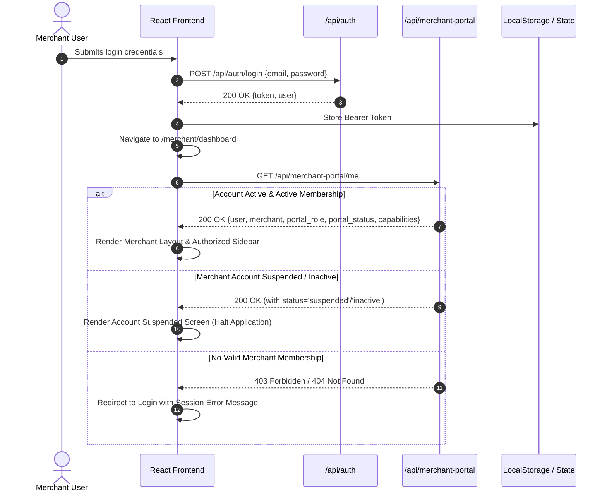
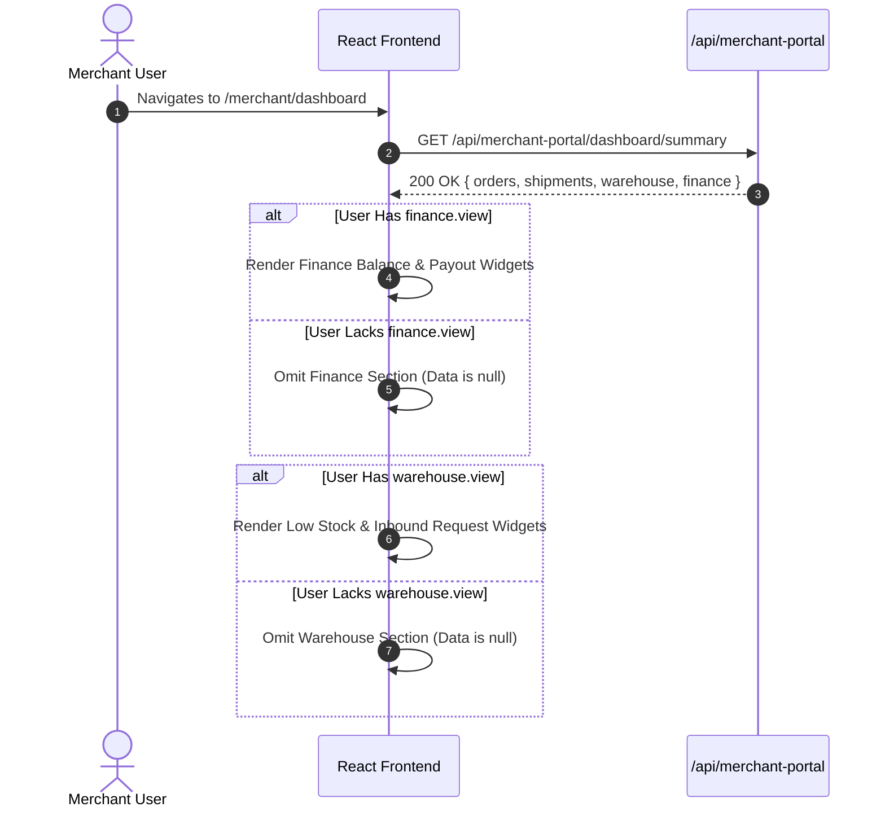
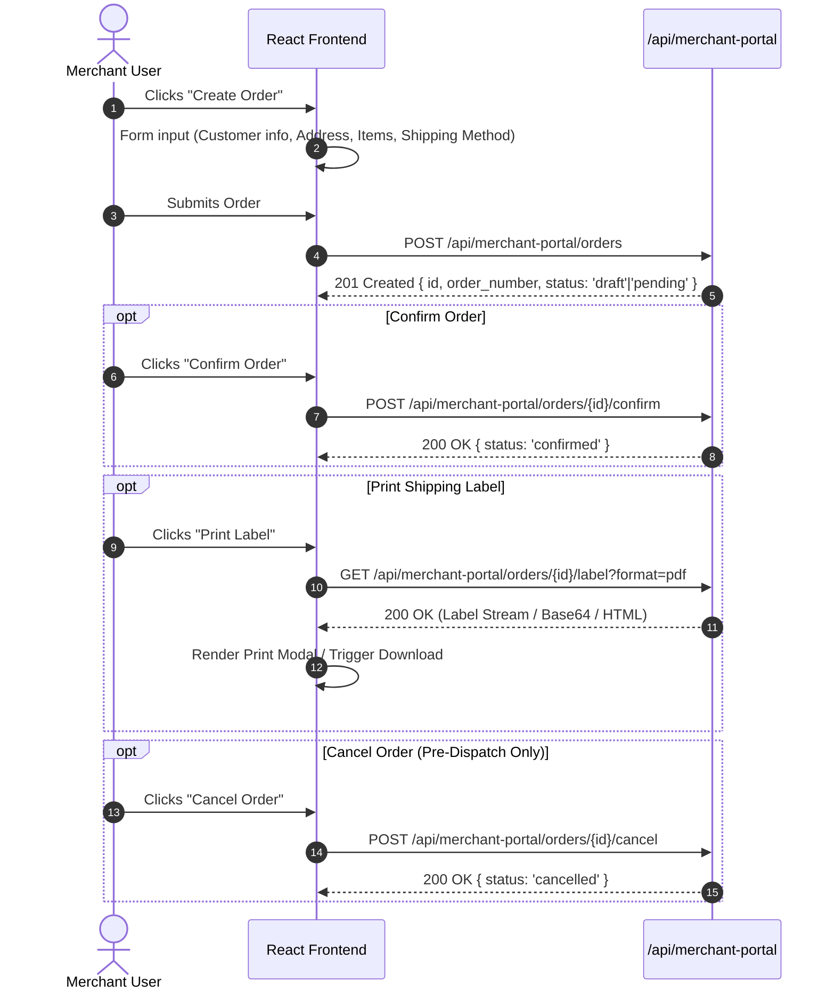
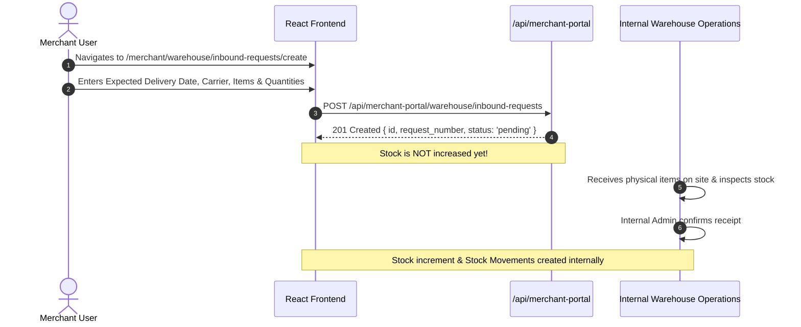
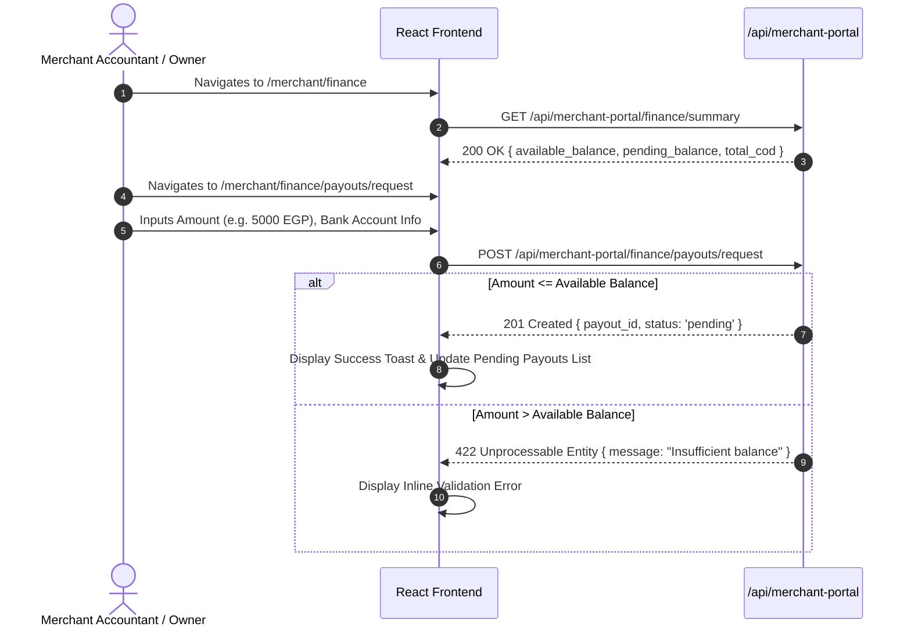
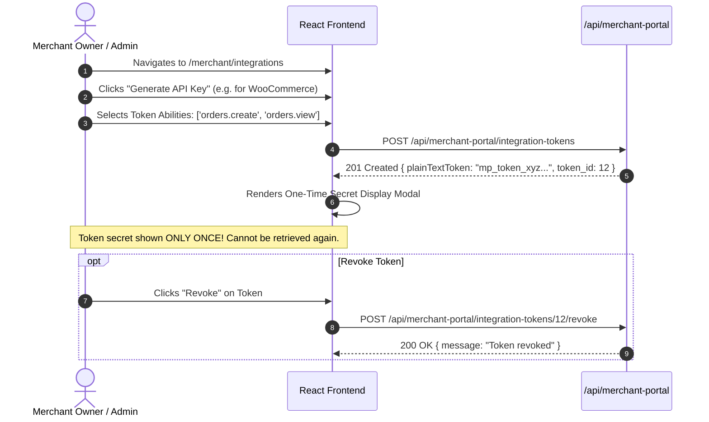
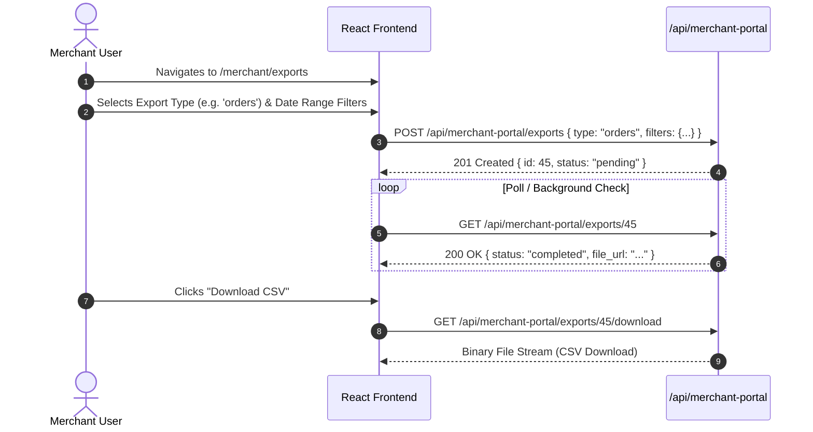

# Merchant Frontend System Flow & Privileges Documentation

> **Purpose**: This document provides a comprehensive specification of the Merchant Frontend Portal, including the merchant-scoped Role-Based Access Control (RBAC) privilege matrix, capability enforcement, screen navigation architecture, system workflows, security boundaries, and API integration flows.

---

## 1. System Overview & Architecture

The **Merchant Portal** is the merchant-facing web application of the Logistics & Warehouse Monolith. It enables merchants to manage their inventory, create and track fulfillment orders and shipments, submit warehouse inbound stock requests, manage wallet balances, request payouts, download financial invoices, generate API tokens for external e-commerce integrations (WooCommerce / Shopify), and manage team members.

### Core Architectural Principles

1. **Strict Context Isolation**:
   - The merchant context is determined strictly from the authenticated Sanctum session (`merchant_users` pivot table binding).
   - Passing `merchant_id` in URL parameters, query strings, or request bodies is strictly forbidden and rejected (`422 Unprocessable Entity`).
   - Any attempt to access resources belonging to another merchant returns `404 Not Found`.

2. **Decoupled Internal vs. Merchant Roles**:
   - Merchant roles (`owner`, `admin`, `staff`, `accountant`, `warehouse_viewer`) are **merchant-scoped**.
   - Merchant roles operate independently of internal system admin/dispatcher roles (`super_admin`, `dispatcher`, `warehouse_manager`, etc.).

3. **Capability-Driven UI Rendering**:
   - Views, navigation menu items, action buttons, and route transitions are governed dynamically by the `capabilities` array returned from `GET /api/merchant-portal/me`.

---

## 2. Merchant Roles & Privilege Matrix

The Merchant Portal defines **5 distinct merchant-scoped roles**. Each role maps to a curated set of capabilities:

### Role Definitions

| Role | Role Code | Primary Focus | Description |
| :--- | :--- | :--- | :--- |
| **Owner** | `owner` | Account & Business Management | Full, unrestricted administrative authority over the merchant account, company profile, team member roles, billing, and API keys. |
| **Admin** | `admin` | Operations & Team Supervision | Administrative control over all day-to-day operations (orders, warehouse, team, finance), excluding top-level company owner profile modifications. |
| **Staff** | `staff` | Order Processing & Shipping | Operational staff responsible for creating orders, printing shipping labels, tracking packages, and submitting inbound stock requests. No access to financial balances. |
| **Accountant** | `accountant` | Finance & Invoicing | Financial specialist focused on tracking ledger transactions, reviewing wallet balances, downloading invoices, requesting payouts, and exporting financial CSVs. |
| **Warehouse Viewer** | `warehouse_viewer` | Inventory & Stock Monitoring | Stock supervisor or warehouse clerk restricted to viewing inventory levels, monitoring low-stock alerts, tracking stock movements, and printing product barcode labels. |

---

### Capabilities & Privileges Matrix

The table below details all capabilities and their assignment across merchant roles:

| Category | Capability Code | Capabilities Description | Owner | Admin | Staff | Accountant | Warehouse Viewer |
| :--- | :--- | :--- | :---: | :---: | :---: | :---: | :---: |
| **Dashboard** | `dashboard.view` | Access portal overview & metrics summary | ✅ | ✅ | ✅ | ✅ | ✅ |
| **Profile** | `profile.view` | View company profile details | ✅ | ✅ | ❌ | ❌ | ❌ |
| | `profile.update` | Update company profile details | ✅ | ❌ | ❌ | ❌ | ❌ |
| **Team Users** | `users.view` | View team members & roles | ✅ | ✅ | ❌ | ❌ | ❌ |
| | `users.manage` | Invite, update, or remove team members | ✅ | ✅ | ❌ | ❌ | ❌ |
| **Orders** | `orders.view` | List and view order details & labels | ✅ | ✅ | ✅ | ❌ | ❌ |
| | `orders.create` | Create new fulfillment orders | ✅ | ✅ | ✅ | ❌ | ❌ |
| | `orders.update` | Edit draft/pending orders & cancel orders | ✅ | ✅ | ✅ | ❌ | ❌ |
| **Shipments** | `shipments.view` | List & view tracking, labels, waybills | ✅ | ✅ | ✅ | ❌ | ❌ |
| **Warehouse** | `warehouse.view` | View catalog, stock levels & movements | ✅ | ✅ | ✅ | ❌ | ✅ |
| | `warehouse.inbound_requests.view` | List & view inbound stock requests | ✅ | ✅ | ✅ | ❌ | ✅ |
| | `warehouse.inbound_requests.create` | Create inbound stock notification | ✅ | ✅ | ✅ | ❌ | ✅ |
| | `warehouse.inbound_requests.cancel` | Cancel pending inbound stock requests | ✅ | ✅ | ✅ | ❌ | ✅ |
| **Finance** | `finance.view` | Access finance summary dashboard | ✅ | ✅ | ❌ | ✅ | ❌ |
| | `wallet.view` | View wallet balance & transaction ledger | ✅ | ✅ | ❌ | ✅ | ❌ |
| | `invoices.view` | List, view, preview & download invoices | ✅ | ✅ | ❌ | ✅ | ❌ |
| | `invoices.download` | Download invoice PDF documents | ✅ | ✅ | ❌ | ✅ | ❌ |
| | `payouts.view` | List & view payout request history | ✅ | ✅ | ❌ | ✅ | ❌ |
| | `payouts.request` | Submit new payout withdrawal request | ✅ | ✅ | ❌ | ✅ | ❌ |
| **Labels** | `labels.print` | Generate & print order/product labels | ✅ | ✅ | ✅ | ❌ | ✅ |
| **Integrations**| `integrations.view` | View active integration tokens & guides | ✅ | ✅ | ❌ | ❌ | ❌ |
| | `integrations.manage` | Generate, edit, and revoke API tokens | ✅ | ✅ | ❌ | ❌ | ❌ |
| **Exports** | `exports.view` | View generated CSV export files | ✅ | ✅ | ✅ | ✅ | ✅ |
| | `exports.create` | Request background CSV exports | ✅ | ✅ | ✅ | ✅ | ✅ |
| | `exports.download` | Download completed export files | ✅ | ✅ | ✅ | ✅ | ✅ |
| **Attachments** | `attachments.view` | View attachments on orders/payouts | ✅ | ✅ | ✅ | ✅ | ✅ |
| | `attachments.upload` | Upload supporting document attachments | ✅ | ✅ | ✅ | ✅ | ❌ |
| | `attachments.delete` | Delete uploaded document attachments | ✅ | ✅ | ❌ | ❌ | ❌ |
| **Store** | `store.view` | Access storefront configuration & view | ✅ | ✅ | ❌ | ❌ | ❌ |

---

## 3. Frontend Route Map & Navigation Architecture

The Merchant Portal frontend uses a dynamic capability-guarded routing tree under the `/merchant` prefix:

```text
/merchant
├── /login                            # Public: Merchant user authentication
├── /403                              # Public: Forbidden capability error screen
├── /404                              # Public: Not found fallback screen
└── /                                 # Protected Layout (Requires Auth & Active Merchant Session)
    ├── /dashboard                    # Protected: requireCapability('dashboard.view')
    ├── /orders                       # Protected: requireCapability('orders.view')
    │   ├── /create                   # Protected: requireCapability('orders.create')
    │   ├── /:orderId                 # Protected: requireCapability('orders.view')
    │   └── /:orderId/edit            # Protected: requireCapability('orders.update')
    ├── /shipments                    # Protected: requireCapability('shipments.view')
    │   └── /:shipmentId              # Protected: requireCapability('shipments.view')
    ├── /warehouse
    │   ├── /products                # Protected: requireCapability('warehouse.view')
    │   │   └── /:productId          # Protected: requireCapability('warehouse.view')
    │   ├── /inventory                # Protected: requireCapability('warehouse.view')
    │   │   ├── /low-stock            # Protected: requireCapability('warehouse.view')
    │   │   └── /:inventoryStockId    # Protected: requireCapability('warehouse.view')
    │   ├── /movements               # Protected: requireCapability('warehouse.view')
    │   ├── /charges                 # Protected: requireCapability('warehouse.view')
    │   └── /inbound-requests        # Protected: requireCapability('warehouse.inbound_requests.view')
    │       ├── /create              # Protected: requireCapability('warehouse.inbound_requests.create')
    │       └── /:inboundRequestId   # Protected: requireCapability('warehouse.inbound_requests.view')
    ├── /finance                      # Protected: requireCapability('finance.view')
    │   ├── /wallet                   # Protected: requireCapability('wallet.view')
    │   │   └── /transactions         # Protected: requireCapability('wallet.view')
    │   │       └── /:transactionId   # Protected: requireCapability('wallet.view')
    │   ├── /invoices                 # Protected: requireCapability('invoices.view')
    │   │   └── /:invoiceId           # Protected: requireCapability('invoices.view')
    │   └── /payouts                  # Protected: requireCapability('payouts.view')
    │       ├── /request              # Protected: requireCapability('payouts.request')
    │       └── /:payoutId            # Protected: requireCapability('payouts.view')
    ├── /users                        # Protected: requireCapability('users.view')
    ├── /profile/*                    # Protected: requireRole('owner')
    ├── /settings                     # Protected: requireCapability('settings.view')
    ├── /integrations/*               # Protected: requireCapability('integrations.view')
    ├── /exports                      # Protected: requireCapability('exports.view')
    │   ├── /create                   # Protected: requireCapability('exports.create')
    │   └── /:exportId                # Protected: requireCapability('exports.view')
    └── /store                        # Protected: requireCapability('store.view')
```

---

## 4. Detailed System Flows

### Flow 1: Authentication & Session Initialization



#### Step-by-Step Flow Description:
1. User enters email and password at `/merchant/login`.
2. Frontend issues `POST /api/auth/login`. On success, Sanctum Bearer token is saved in state and HTTP header defaults.
3. React Router mounts the protected `/merchant` layout inside `MerchantPortalProvider`.
4. `MerchantPortalProvider` automatically triggers `GET /api/merchant-portal/me`.
5. Response returns authenticated user data, company details, active role, and capability array.
6. **Account Inactivity Check**: If `merchant.status === 'inactive'|'suspended'` OR `portal_status !== 'active'`, access is halted immediately and a full-screen **Suspended Banner** is rendered, advising the user to contact operations.

---

### Flow 2: Dashboard Metrics & Dynamic Widget Visibility



#### Step-by-Step Flow Description:
1. User accesses `/merchant/dashboard`.
2. App queries `GET /api/merchant-portal/dashboard/summary`.
3. Backend filters metrics dynamically based on the requesting user's capabilities:
   - Non-financial roles (`staff`, `warehouse_viewer`) receive `"finance": null`.
   - Non-warehouse roles (`accountant`) receive `"warehouse": null`.
4. Frontend renders summary cards (Total Orders, Pending Shipments, Low Stock SKUs, Available Balance) according to present non-null keys.

---

### Flow 3: Order Creation & Lifecycle Flow



#### Step-by-Step Flow Description:
1. User navigates to `/merchant/orders/create` (requires `orders.create`).
2. Fills out recipient details, pickup location, and selects products (from warehouse inventory or manual SKU entry).
3. Submitting sends `POST /api/merchant-portal/orders`. **Note**: `merchant_id` is NOT passed in the payload.
4. Order lifecycle updates:
   - Draft orders can be updated via `PUT /api/merchant-portal/orders/{id}` or confirmed via `/confirm`.
   - Cancellation is allowed strictly prior to shipment dispatch.
   - Labels can be fetched in `html`, `pdf`, `zpl`, or `tspl` formats via `GET /api/merchant-portal/orders/{id}/label`.

---

### Flow 4: Warehouse Inbound Stock Request Flow



#### Step-by-Step Flow Description:
1. Merchant wants to ship products to the fulfillment warehouse.
2. Navigates to `/merchant/warehouse/inbound-requests/create` (requires `warehouse.inbound_requests.create`).
3. Submits expected arrival date, notes, and line items (product ID, quantity).
4. **Critical Business Rule**: Submitting an inbound request creates a pending notification record **without modifying physical stock counts or creating ledger movements**. Stock increases only when internal warehouse staff perform physical receiving via internal admin tools.

---

### Flow 5: Finance Ledger, Invoices & Payout Request Flow



#### Step-by-Step Flow Description:
1. User accesses `/merchant/finance` (requires `finance.view`).
2. Displays real-time breakdown of `available_balance`, `pending_balance`, `total_cod_collected`, and `unpaid_invoices_count`.
3. **Payout Request**:
   - User clicks "Request Payout" (`/merchant/finance/payouts/request`, requires `payouts.request`).
   - Submits requested withdrawal amount, bank account details, and optional notes.
   - API verifies that requested amount does not exceed `available_balance`.
4. **Strict Boundary Rule**: Merchant users can **only request payouts**. They CANNOT approve payouts, mark payouts as completed, create manual ledger adjustments, or edit issued invoices. Payout approval and funds transfer execution remain strictly internal admin functions.

---

### Flow 6: Developer E-Commerce Integration Tokens Flow



#### Step-by-Step Flow Description:
1. User accesses `/merchant/integrations` (requires `integrations.view` and `integrations.manage`).
2. Fills form with Token Name (e.g., "Main Store Shopify Plugin"), Expiration Date, and granted abilities (`orders.create`, `orders.view`, `shipments.view`, `tracking.view`).
3. Backend creates Sanctum personal access token tied implicitly to the merchant's ID.
4. Plain-text API key is returned in response **exactly once**. The frontend displays a warning copy modal.
5. In case of security exposure, user can immediately revoke tokens via `POST /api/merchant-portal/integration-tokens/{id}/revoke`.

---

### Flow 7: Asynchronous CSV Exports Flow



#### Supported Export Types:
- `orders` (Orders list & status)
- `shipments` (Shipment tracking history & delivery statuses)
- `warehouse_inventory` (Current stock SKU levels)
- `stock_movements` (Historical stock receipts/adjustments log)
- `wallet_transactions` (Financial ledger entries)
- `invoices` (Issued billing invoices)
- `payouts` (Payout request log & statuses)
- `inbound_stock_requests` (Inbound stock delivery logs)

---

## 5. Security & Scoping Rules

| Security Aspect | Implementation Rule | Enforced Response |
| :--- | :--- | :--- |
| **Authentication** | All portal endpoints require valid Sanctum bearer token (`auth:sanctum`). | `401 Unauthorized` |
| **Merchant Context Binding** | Context resolved exclusively via authenticated user's `merchant_users` database record. | `403 Forbidden` if user has no active merchant mapping |
| **No Request Injection** | `merchant_id` parameter submitted in request body or URL parameters is strictly rejected. | `422 Unprocessable Entity` |
| **Cross-Tenant Isolation** | Resource IDs queried outside the merchant's authorized scope are treated as non-existent. | `404 Not Found` |
| **Inactivity / Suspension** | Attempts to access portal when merchant or user membership is `inactive` or `suspended`. | `403 Forbidden` + Suspended UI view |
| **Internal Data Redaction** | Internal carrier rates, profit margins, vehicle numbers, driver phone numbers, and operational notes are excluded from responses. | Hidden at API Serializer layer |

---

## 6. Localization & Language Support

The Merchant Portal frontend natively supports dual-language operation (**Arabic / English**):

1. **Header Negotiation**:
   - `X-Locale: ar|en` or `Accept-Language: ar|en` sent with every request.
2. **Localized API Response Labels**:
   - In addition to raw code keys (`status: "delivered"`), APIs return localized display labels based on the requested locale:
     - `status_label` ("تم التسليم" / "Delivered")
     - `portal_role_label` ("مدير حساب" / "Admin")
     - `type_label` ("طلب إيداع" / "Inbound Request")
3. **RTL Directional Layout**:
   - When Arabic locale is selected, the frontend layout switches to `dir="rtl"`, flipping navigation sidebars, tables, and form field alignments automatically.

---

## 7. Operational Separation Summary (Admin vs. Merchant)

To maintain platform integrity, operational and administrative tasks are strictly segmented between the Admin Portal and the Merchant Portal:

| Task / Operation | Admin Portal | Merchant Portal |
| :--- | :---: | :---: |
| Create Order / Submit Inbound Request | ✅ | ✅ |
| Track Shipments & View Invoices | ✅ | ✅ |
| Request Financial Payout | ❌ | ✅ |
| **Approve / Complete Payouts** | ✅ | ❌ (Read-only status) |
| **Physical Stock Receipt & Inventory Increment** | ✅ | ❌ (Request only) |
| **Assign Drivers & Update Shipment Dispatch Status** | ✅ | ❌ (Read-only view) |
| **Manual Wallet Ledger Adjustments** | ✅ | ❌ (Read-only view) |
| **Issue / Edit Merchant Invoices** | ✅ | ❌ (Read-only download) |
| **System-wide Rate & Zone Pricing Configuration** | ✅ | ❌ (No access) |

---

## 8. Summary Checklist for Frontend Developers

- [x] Integrate `MerchantPortalProvider` in router tree to wrap all `/merchant/*` routes.
- [x] Fetch `GET /api/merchant-portal/me` on session boot and store `capabilities` array in Context.
- [x] Wrap protected routes with `requireCapability(Component, 'capability.code')`.
- [x] Use `hasMerchantCapability('cap')` to show/hide dynamic UI elements (buttons, menu options).
- [x] Handle `404` for missing/cross-merchant resource lookups seamlessly.
- [x] Do NOT send `merchant_id` in API request payloads.
- [x] Implement locale switcher passing `X-Locale` header with RTL layout support.
